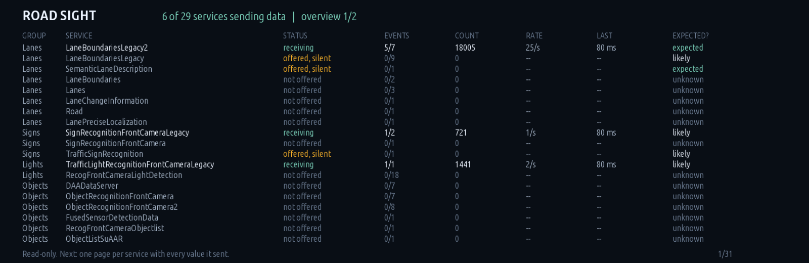
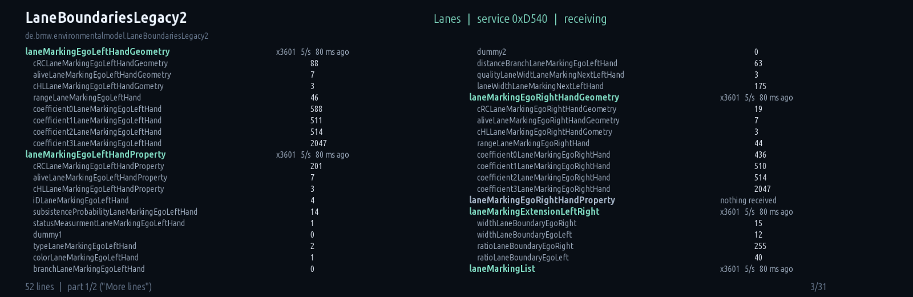

# Road Sight

An iDrive 7 (MGU) app that lists everything the car reports about what it sees:
lane markings, traffic signs, traffic lights, objects around the car, and the
warnings built on them. It only listens. **It has not run on a car.**

## What it does

- Subscribes to 88 notifications across 29 services (list below).
- **Overview page:** one row per service with status, how many of its events
  have arrived, total count, rate, time since the last one, and whether the
  files say to expect it.
- **One page per service:** every event with its count, rate and age, then every
  value of the latest event as `name = value`. Lists show how many entries are
  filled and the first four. Long events split into parts.
- **Log:** the first value of each event is written to the app log once, and
  "Log all" writes the latest value of everything on demand. That log is the
  material for working out units and scaling afterwards.

It does not start by itself; open it from the app menu.

## Preview

Drawn by `tools/preview.cjs` with the app's own drawing code and **invented
values**. These are not captures from a car.





## Buttons

| Button | Does |
|---|---|
| Previous / Next | move through the pages |
| Overview | back to the first page |
| Live only | hide services that have sent nothing |
| More lines | next part of a long service page |
| Log all | write every latest value to the log |

## Reading the overview

| Status | Meaning |
|---|---|
| receiving | events are arriving |
| offered, silent | a unit offers the service but has sent nothing yet |
| not offered | no unit on this car offers it |
| refused | the head unit did not allow the subscription (see the log) |

"Expected?" comes from the offline analysis, not from the car:
`expected` = the head unit's own configuration rate-limits the service,
`likely` = it is in the BDC gateway's table, `unknown` = only defined.

## Services

| Group | Services |
|---|---|
| Lanes | LaneBoundariesLegacy2, LaneBoundariesLegacy, SemanticLaneDescription, LaneBoundaries, Lanes, LaneChangeInformation, Road, LanePreciseLocalization |
| Signs | SignRecognitionFrontCameraLegacy, SignRecognitionFrontCamera, TrafficSignRecognition |
| Lights | TrafficLightRecognitionFrontCameraLegacy, RecogFrontCameraLightDetection |
| Objects | DAADataServer, ObjectRecognitionFrontCamera, ObjectRecognitionFrontCamera2, FusedSensorDetectionData, RecogFrontCameraObjectlist, ObjectListSuAAR, GapVehicleAhead, ParkDistanceInformation |
| Warnings | LateralCollisionAvoidance, AssistedDrivingViewLateralCollisionAvoidance, AssistedDrivingViewFunctionInput, AssistedDrivingViewLateralFunctionInput |
| Conditions | Weather, BlockageAndWeatherFrontCameraMain, EgoMotionLegacy, AutonomousDrivingOffboardRoadApproval |

The exact list is `apps/road_sight/services.js`, generated from the owner's
catalog by `tools/gen_services.py`.

## Safety

Read-only by construction: for the car-side services the manifest declares
notifications only, with no writable field and no method. A test fails the build
if that changes. Do not operate the screen while driving; let it collect and
read the log afterwards.

## Build

```
python tools/gen_services.py <your catalog.json>   # only after the catalog changes
node --test tests/*.test.cjs
node tools/check-node8.cjs
python tools/build.py
```

Output: `dist/road_sight@<version>.tgz`. The build uses the pinned MIT app kit
(`cauliflowermossgrape/idrive7-apps` at `2c6cfdf`) and does not include BMW's
SDK. Install the `.tgz` through MGU Store.

## Limits

- Values are shown as the car sends them. Most legacy lane, sign and light
  values are raw numbers without a unit.
- 88 subscriptions is more than a normal app holds. If the head unit refuses
  some, the overview shows which; the rest keep working.
- Large object lists can arrive many times a second. The app only stores the
  latest value and formats it when a page is drawn, twice a second.
